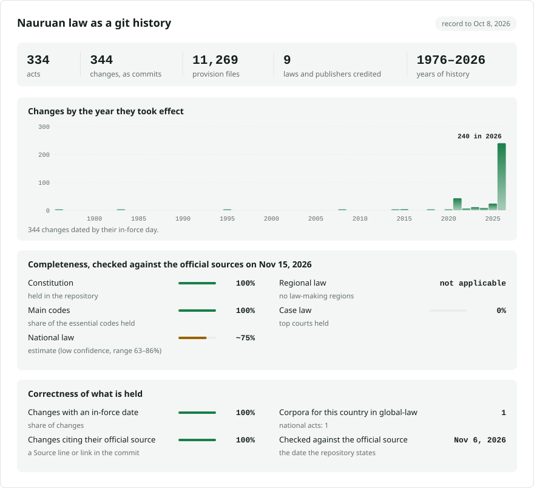

# Nauru: law history in git

<picture>
<source media="(prefers-color-scheme: dark)" srcset="data/effort-dark.svg">

</picture>

The law of Nauru (Naoero) as a git history: one file per article, section, regulation or schedule, one commit per version on the day it took effect, and the Act that made each change as the commit's author. `git blame` names the Act behind every line; `git log` lists every change to a provision; picking a date gives the text in force that day.

Part of [lexifina/global-law](https://github.com/lexifina/global-law), one git history for every country's law: this is Nauru's national law, which global-law reads at `nauru/national/acts/`.

**What is in it now:** the Constitution and the Public Service Act 2016, with their changes since RONLAW's earliest reprint of each (June 2022) as dated commits (7 for the Constitution, 6 for the Act); and 187 other Acts and 145 subsidiary instruments (regulations, rules, orders and notices), each as one current text. [`corpus.json`](corpus.json) lists every instrument with its folder, reprint and day; [`data/runner-held.csv`](data/runner-held.csv) lists what is held back (173 entries), with the reason.

The Constitution is in `constitution/` (`constitution/article/19.md` is Article 19, the appointment of Ministers and the Vice President) and the Public Service Act in `public-service-act-2016/`; every other Act is in `acts/<title>/` and every subsidiary instrument in `subsidiary/<title>/` (`acts/workers-contracts-of-service-act-1922/section/1.md`).

The text is in English, as RONLAW's reprints print it; their history notes stay in brackets where they print them (`[Art 19 subst Act 6 of 2025 s 4, opn 11 Mar 2025]`).

## Questions as git commands

| Question | Command |
| --- | --- |
| Every change to Article 19 of the Constitution | `git log -p --word-diff -- constitution/article/19.md` |
| Which Act wrote each line of Article 19? | `git blame constitution/article/19.md` |
| Every version of the Constitution, with the day each took effect | `git log --format="%h %(trailers:key=In-force,valueonly,separator=) %an" -- constitution` |
| Article 19 as in force on 1 April 2026 | `python tools/in_force_on.py 2026-04-01 constitution article/19` |

**Outside git**, we also host this record publicly, for free:

- **[Ask Claude about Nauruan law](https://global-law.lexifina.com/v1/try_claude?country=nauru)**: opens Claude with a first question ready.
- **[Ask ChatGPT](https://global-law.lexifina.com/v1/try_chatgpt?country=nauru)**: the same question in ChatGPT.
- **[Search Nauruan law on our site](https://lexifina.com/law?country=nauru&q=annual+leave)**: a search for "annual leave", with each provision's text and its versions, no account needed.
- **[Developer REST API](https://global-law.lexifina.com/v1/search_law?query=annual+leave&jurisdiction=nauru)**: the same search as JSON, with no key. See the [documentation here](https://lexifina.com/api/global-law).

Both assistants read the record through the free Global law connector (MCP, `https://global-law.lexifina.com/mcp`); the first time, the chat gives you the link that adds it. Ask in English.

**Host it yourself easily.** All it takes is git and Python, and the tools run on your machine:

```sh
git clone --depth 1 https://github.com/lexifina/global-law && cd global-law
python3 tools/countries.py add nauru/national/acts
python3 tools/law.py show 2026-01-01 nauru/national/acts/constitution/article/19.md
```

Opened in Claude Code, Cursor, VS Code or Codex, the clone also starts a local MCP server with the same tools ([MCP.md](https://github.com/lexifina/global-law/blob/main/MCP.md)).

## Dates

Each commit is dated at noon, Nauru time (UTC+12, no summer time), on the day the version took effect, and carries it in its `In-force:` trailer:

- for a change to the Constitution or the Public Service Act, the operative day its history note prints ("opn 16 Apr 2026"); where the changed provision has no new note, the commencement the Table of Amendments gives for the one Act newly listed;
- for the first version of those two, the day RONLAW's earliest reprint is consolidated to (8 and 10 June 2022); earlier changes appear only in its history notes;
- for every other instrument, the latest commencement in its reprint's Table of Amendments (1976 to 2026); the day does not claim the same words applied earlier.

Each change is credited to the Act that made it, at an address that cannot exist (`Constitution (Amendment) Act 2026 No 18 <act-2026-18@ronlaw-gov-nr.invalid>`). First versions, single texts, a change two Acts could explain (`Kind: several-acts`) and one nothing explains (`Kind: unexplained`) are credited to `RONLAW (Department of Justice and Border Control)`.

## How it is checked

- `tools/build/check_repo.py` rebuilds every reprint of the Constitution and the Public Service Act from its PDF and compares it, byte for byte, with the files in git on the day it is consolidated to, then letter for letter with the PDF's raw words: 8 of 8 versions match (see [`REPRODUCE.md`](REPRODUCE.md)).
- `tools/build/test_repo.py` checks that blame names an Act, that the text differs before and after an amendment, and the log order, trailers and authors.
- Every single-text instrument names the reprint it was read from and that PDF's sha256 (`Source:`, `Source-SHA256:`); instruments whose words, day or status did not check out are held back, not committed.
- A second build of the two dated histories from the same retrieved files gave the same head.

## What it does not show

- **Earlier wording of most law.** 332 of the 334 instruments are one current text; the Constitution and the Public Service Act go back only to June 2022.
- **Held instruments.** 102 instruments that carry official images wait until the images can be placed; others are held as repealed, spent or absent from the newest reprint, or because their day or words did not check out (`data/runner-held.csv`).
- **Images.** The two official images in the Public Service Act's schedules are not in its files.
- **Later commencement of parts of an Act**, and savings or transitional rules in amending Acts.
- **As-made Acts, bills, the Government Gazette and court decisions**, which RONLAW also holds.

## Sources

| Source | Kind | Past versions | Notes |
| --- | --- | --- | --- |
| [RONLAW](https://ronlaw.gov.nr) (Department of Justice and Border Control) | Official consolidated reprints of the Laws of the Republic of Nauru | some: earlier reprints of an Act | The text, each reprint's Table of Amendments and its history notes; the Government's consolidation: the certified Acts and the Gazette prevail |

## Licence

See [`LICENSE`](LICENSE). The texts are not protected by copyright: the Copyright Act 2019 (Nauru), section 15(4), gives none in any Act or regulations, and section 19(b) excludes "any official text of a legislative, administrative or legal nature". The tools, data files, arrangement and commit messages are CC0 1.0.

No AI model wrote or edited legal text, and none runs when the history is built; the scripts were written by an AI model (see [`REPRODUCE.md`](REPRODUCE.md)).

## More

From [lexifina/global-law](https://github.com/lexifina/global-law):

- [FEATURES.md](https://github.com/lexifina/global-law/blob/main/FEATURES.md): every feature, and what every corpus must support (`git blame`, `law.py`, the MCP tools)
- [FAQ.md](https://github.com/lexifina/global-law/blob/main/FAQ.md): questions and answers · [CONTRIBUTING.md](https://github.com/lexifina/global-law/blob/main/CONTRIBUTING.md): proposing changes · [MCP.md](https://github.com/lexifina/global-law/blob/main/MCP.md): the MCP server · [REPRODUCE.md](https://github.com/lexifina/global-law/blob/main/REPRODUCE.md): how it was built · [CHANGELOG.md](https://github.com/lexifina/global-law/blob/main/CHANGELOG.md)
- [FRESHNESS.md](https://github.com/lexifina/global-law/blob/main/FRESHNESS.md): how current each corpus is · [Monitoring](https://github.com/lexifina/global-law/tree/main/monitoring): whether updates are running · [WATCHING.md](https://github.com/lexifina/global-law/blob/main/WATCHING.md): how each official source is watched for changes
- [performance/](https://github.com/lexifina/global-law/tree/main/performance): how fast the tools are, measured
- [visualisations/](https://github.com/lexifina/global-law/tree/main/visualisations): charts and bridges across the world's law
- [Vulnerabilities](https://github.com/lexifina/global-law/tree/main/vulnerabilities): mistakes in legislation as published
