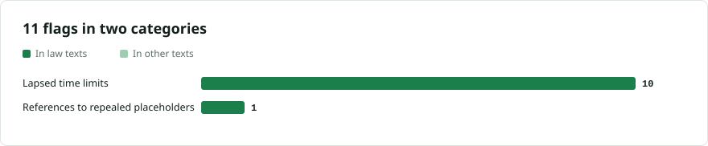

# Vulnerabilities in Nauruan law

<picture>
<source media="(prefers-color-scheme: dark)" srcset="img/flags-by-category-dark.svg">

</picture>

The vulnerability detectors from [lexifina/global-law](https://github.com/lexifina/global-law/tree/main/vulnerabilities) look for mechanical mistakes in legislation: a rule applying "until" a date that has passed, a provision repealed before its replacement took effect, two amendments to the same provision on the same day, an amount changed in one place but not in another, a reference to a section that no longer exists. global-law's published list (9 November 2026) had no flags for Nauru, though this repository was already part of global-law then. This is a run over this repository only, as it stood at commit [`c50a240`](https://github.com/lexifina/nauru-law/commit/c50a24056b714a0fbc7ed6caf7867503324b7a63) on 16 November 2026: the Constitution and the Public Service Act 2016 with their changes since June 2022, and 187 other Acts and 145 subsidiary instruments, each as one current text from RONLAW's official reprints.

**In short:** the detectors raised 11 flags, and none is a mistake in Nauruan law. Ten are lapsed time limits, and each is spent wording that a current reprint still prints: the signature clauses of the three conventions scheduled to the Diplomatic, Consular and Special Missions Privileges and Immunities Acts 1976 (open for signature "until 31 October 1961", "until 31st March, 1964", "until 31st December 1970"), the delayed start of the Weights and Measures Act 1976 for weighing (until 1 January 1978) and for liquid fuel (until 1 January 1981), the transitional rules of the Education Act 2011 (section 117(2), until 1 January 2015) and the Naoero Superannuation Act 2018 (section 67(2), an amnesty until 30 June 2019), and the words "Until 30 June 2014" that section 41 of the RONWAN Consolidation Act 2014 inserted into another Act. They are flagged because this repository dates each single text by the latest commencement in its reprint's Table of Amendments, for nine of the ten 12 May 2026, the day the Constitution (Amendment) (No 2) Act 2026 put "Naoero" for "Nauru" throughout the law. The model reviewed all ten: eight artefacts, two lawful, none kept. The eleventh flag is section 39 of the Matrimonial Causes Act 1973, whose definition of "former spouse" still relies on section 50, a section the Law Revision Commission omitted from the reprint; the Law Revision and Consolidation Act 2019 says that a law the Commission omits does not lose its force for that reason (section 15(6)). Before fixes to three of the detectors' scripts, 3 flags were raised that are now gone (a reprint's history note read as a reference, "a repealed Act" read as the mark of a repealed section) and 5 of the ten lapsed limits were missed, as the detectors did not read "1st January 1978" or "31st October, 1963" as dates. 332 of the 334 instruments here are one current text, so the detectors that compare versions (repeal gaps, same-day conflicts, retroactive dates, empty periods, stale amounts, references to deleted provisions) could only compare the Constitution's and the Public Service Act's versions, and found nothing in them. The detectors found no mistake in Nauruan law. Reading the 2026 renaming turned up one problem in the reprinted Constitution, listed below. Later, this will be formalised in Lean, similar to our work on [the US tax code](https://lexifina.com/blog/formalizing-the-us-tax-code) and [US case law](https://lexifina.com/blog/formalizing-all-us-case-law-in-lean).

A flag is a prompt to look, not legal advice, and nothing here has been tested in court.

## Flags by category

| Category | What it looks for | Flags | In law texts | Reviewed | Survived review |
| --- | --- | ---: | ---: | ---: | ---: |
| Lapsed time limits | A rule that applies "until" a date that has passed, in text still in force | 10 | 10 | 10 | 0 |
| References to repealed placeholders | A reference to a provision that is now only "[Repealed]" or "omitted" | 1 | 1 | 0 | 0 |

"In law texts" counts all the law this repository holds: the Constitution (`constitution/`), the Public Service Act 2016 (`public-service-act-2016/`), the 187 other Acts (`acts/`) and the 145 regulations, rules, orders and notices (`subsidiary/`), with their schedules, among them the treaties scheduled to an Act. The other files are this repository's root files (`README.md`, `REPRODUCE.md`, `SOURCES.md`, the licence, `corpus.json`), `data/` and `tools/`; none has a flag. The history has 344 changes to the law: the 332 single texts and the first versions of the Constitution and the Public Service Act (`Kind: consolidated`), eight amending Acts, and the two Public Service Act changes credited to more than one Act or to none (`Kind: several-acts`, `Kind: unexplained`). The history detectors compare the versions of a provision, and only the Constitution and the Public Service Act have more than one; they found nothing in them. Amounts are in dollars, the Australian dollar where an Act names it (the Customs Act 2014, section 96; the Employment and Services Tax Act 2014, section 27); the Currency Act 1976 makes legal tender the currency of a country the Minister nominates by Gazette notice. No law text states an amount in pounds, the currency before the dollar, so there are no dead currencies, and pounds were not added to the detector: "pounds" in this repository is a weight (an aircraft's "maximum take-off weight of more than 12.500 pounds", Air Navigation Regulations 1973, regulations 57 and 181) or a rate in the form of policy that the Act sets out ("under three pounds per cent", Marine Insurance Act 1909, Schedule 2), and the one fine in pounds is struck out (Crimes Act 2016, Schedule 2, item 21: "Section 362 omit , and to a fine of two hundred pounds").

*Edge cases: the 11 flags, checked by hand, and what the flags before the fixes were, in [EDGE-CASES.md](EDGE-CASES.md).*

## Problems found in this repository

- **Article 102 of the Constitution renames "Naoero" to "Naoero":** the Constitution (Amendment) (No 2) Act 2026 (Act 21 of 2026, operative 12 May 2026) put "Naoero" for "Nauru" and "Nauruan" throughout the Constitution ([the change](https://github.com/lexifina/nauru-law/commit/4ce18c3e4dd02f5fd8221c9e95bef548f7089df4)) and, by section 6, inserted Article 102, a transitional rule for references in agreements, contracts and registers. In the reprint, as in [`constitution/article/102.md`](https://github.com/lexifina/nauru-law/blob/c50a24056b714a0fbc7ed6caf7867503324b7a63/constitution/article/102.md), the renaming was applied to Article 102 too, and its notes say so ("[Art 102 insrt Act 21 of 2026 s 6, opn 12 May 2026; am Act 21 of 2026 s 5, opn 12 May 2026]"): the heading reads "Transitional provision relating to amendment of reference to ‘Naoero’ to be substituted with ‘Naoero’", and each paragraph of clause (1) says that a reference "to the term ‘Naoero’ shall be deemed to be a reference to the word ‘Naoero’", so the article no longer says which word it replaces. This repository copies the reprint's words; the Act as passed is not in this repository and was not read, so whether its own text reads the same way was not checked.

## Files

| File | What it holds |
| --- | --- |
| [data/flags.csv](data/flags.csv) | Every flag, one row per provision and issue |
| [data/reviewed.csv](data/reviewed.csv) | The flags the model reviewed, with its verdict and reason |
| [data/by_category.csv](data/by_category.csv) | The counts in the table above |
| [tools/](tools/) | The scripts that made this run |

Columns: `category`, `detector`, `kind` (`law` or `other`), `path` (the file in this repository), `date` (the date the flag turns on, where there is one), `reference` (the act or line involved), `summary`, `score` (the detector's ranking, 0 to 1), `review` (`artefact`, `lawful` or `candidate_defect`), `survives_rebuttal`, `review_note` (the model's reason), `url` (the file at the commit that was read).

## How it was made

- **Detectors:** global-law's [vulnerabilities/scripts](https://github.com/lexifina/global-law/tree/main/vulnerabilities/scripts), with the fixes in [tools/patch_detectors.py](tools/patch_detectors.py), the other patches in [tools/](tools/README.md) and, for this repository, [tools/patch_en_nr.py](tools/patch_en_nr.py), run on this repository at commit `c50a240`. The history table the detectors read was built from this repository's own commits (the Act that made each change, and the `In-force` and `Kind` trailers): 344 commits count as law; the three `Kind: documentation` commits and the six that change only the README, other documentation and tools are left out. The corpus language is English, so the detectors read English month names and dates.
- **Model review:** gpt-5.4-mini, the 40 strongest flags per category it reviews, one pass saying whether a flag is real and a second arguing that it is not. Here that was the ten lapsed time limits; there were no flags in the other categories it reviews, and no empty periods. The model does not review references to repealed placeholders.
- **Hand check:** every flag was read in this repository's text, with the Acts and notes it turns on (the Law Revision and Consolidation Act 2019, the history notes of Act 21 of 2026, the list of held instruments in `data/runner-held.csv`), and so were the 3 flags raised before the fixes and the five "until" dates the detectors had missed. Article 102 was found by reading the 2026 renaming in the Constitution's history; it was not checked against RONLAW's PDF or the Act as passed.

To report a correction, open an issue with the provision and an official source.

## Licence

The lists and notes are Lexifina's, dedicated to the public domain under CC0 1.0, like this repository's tools, data files, arrangement and commit messages. Quoted law text is from RONLAW's official reprints of the Laws of the Republic of Nauru (Department of Justice and Border Control); under the Copyright Act 2019, section 15(4), there is no copyright in any Act or regulations, and section 19(b) excludes from protection "any official text of a legislative, administrative or legal nature". See [LICENSE](../LICENSE).
